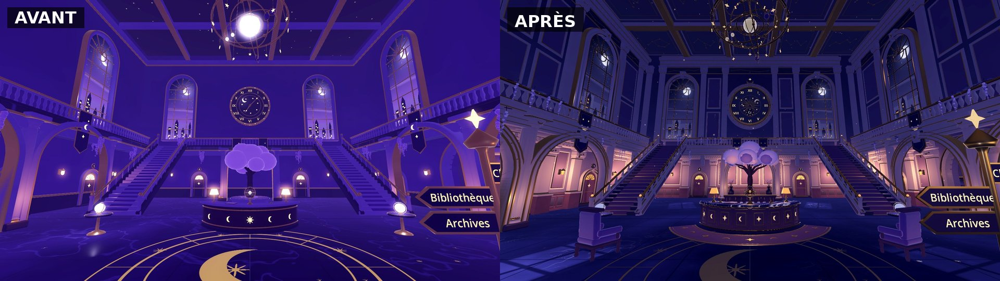
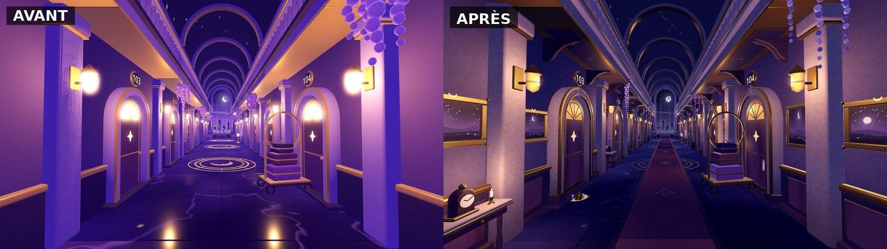
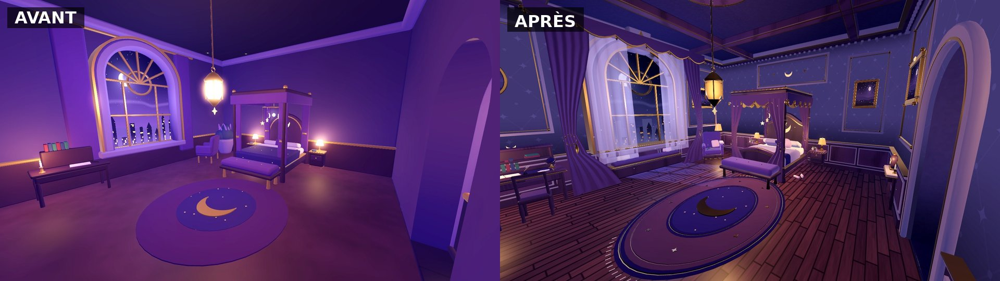

# Wakeless

Jeu d'aventure narratif en 3D, développé sous **Godot 4.3** (GDScript, rendu Forward+).
Le socle technique et graphique vient d'**Éclat** (voxel artisanal, pixels de 2 cm, une palette, un shader) ; Wakeless
en est un jeu **entièrement indépendant** : aucune génération procédurale, des cartes construites à la main.

**État : prototype jouable** — pas encore d'histoire, de dialogues, de personnages secondaires ni d'énigmes.

**Nouveau : le Bureau des rêves en 3D stylisée** (douce, arrondie, cohérente avec Star-Faced One) — scène de démarrage.
Détails : [docs/BUREAU_DES_REVES.md](docs/BUREAU_DES_REVES.md).

**Nouveau : la Forêt de la peur** (branche `claude/foret-de-la-peur`) — premier monde onirique jouable : on s'y
endort depuis le lit de la chambre 107. Plan : [docs/FORET_DE_LA_PEUR.md](docs/FORET_DE_LA_PEUR.md) · captures :
[docs/captures/foret/INDEX.md](docs/captures/foret/INDEX.md).

**Finition esthétique** (branche `claude/bureau-des-reves-finition`) : palette nuit désaturée, lumière chaude contre
clair de lune, architecture moulurée, chambre 107 habitée. Galerie avant / après :
[docs/captures/finition/INDEX.md](docs/captures/finition/INDEX.md) · direction : [docs/FINITION_DIRECTION.md](docs/FINITION_DIRECTION.md).





## Le prototype

1. **Le Bureau des rêves** (`scenes/levels/bureau_des_reves.tscn`, scène de démarrage) : grand atrium sur deux niveaux
   (réception, arbre de lune, deux escaliers, galerie à 6 m, lustre astronomique, horloge céleste, grandes fenêtres sur la nuit),
   couloir des rêveurs (portes 101 à 116), chambre du rêveur (n° 107).
2. **Le rêve** : dans la chambre 107, **E près du lit** (« Se coucher et rêver ») : Star-Faced One s'endort, fondu, la
   **forêt nocturne** (`foret_nocturne.tscn`) se charge comme scène distincte. La porte de la clairière (« Se réveiller »)
   ramène **sur le lit**.
3. Conservés : l'ancien couloir voxel (`bureau_couloir.tscn`, touche F4) et la forêt nocturne.

Personnage : **Star-Faced One** (`assets/characters/star_faced_one/`, 11 animations, voir [docs/GARDIENS.md](docs/GARDIENS.md)).

## Ouvrir et tester sur Mac

1. Télécharger **Godot 4.3 (ou plus récent 4.x) — version standard, pas « .NET »** : <https://godotengine.org/download/macos/>
   puis glisser `Godot.app` dans Applications (au premier lancement : clic droit → Ouvrir).
2. Récupérer le projet : `git clone https://github.com/rambouraxel-del/Wakeless`, puis
   `git checkout claude/foret-de-la-peur` (ou bouton **Code → Download ZIP** sur la branche).
3. Dans Godot : **Importer** → choisir le fichier `project.godot` → **Importer et éditer** (la première ouverture importe les
   ressources, quelques secondes).
4. **F5** (ou ▶ en haut à droite) : le jeu démarre dans l'atrium du Bureau des rêves. Pour lancer un niveau précis : ouvrir la scène puis **F6**.
5. Prendre l'arche à l'est (panneau « Chambres »), longer le couloir jusqu'à la porte **107** (à gauche), **E** pour l'ouvrir,
   puis **E** près du lit pour s'endormir et rêver. Dans la forêt, la porte de la clairière réveille le personnage sur son lit.

| Touche | Action |
|---|---|
| Z Q S D ou W A S D (ou flèches) | Marcher (les deux claviers marchent) |
| Souris | Regarder (clic : recapturer la souris) |
| Maj / Espace | Courir / sauter |
| **E** | Interagir (portes, lit) |
| V | Vue à la 1re ou 3e personne (3e personne au lancement) |
| Alt (maintenu) | Strafe : le gardien garde le regard de la caméra |
| F | Champ de vision 68° → 76° → 84° |
| L | Ambiance d'éclairage suivante (essai) |
| F3 | Informations techniques (FPS, triangles, appels de dessin) |
| F1 / F2 / F4 | Bureau des rêves / forêt / ancien couloir voxel (développement) |
| F11 | Plein écran |
| Échap | Pause |

Personnage : **Star-Faced One**, gardien des rêves flottant de **1,10 m** (`config/player.json`) : voir [docs/GARDIENS.md](docs/GARDIENS.md). L'explorateur provisoire reste disponible (`--gardien=aucun`).

## Vérifier (sans carte graphique)

```bash
GODOT=/Applications/Godot.app/Contents/MacOS/Godot tools/check.sh
```

Importe le projet, compile tous les scripts, lance les contrôles du socle (voxel, assets, références, niveaux, gardien), ceux du
Bureau des rêves (≈ 325 : modules, matériaux, budgets, parcours joué) puis une recette du jeu complet (chambre 107 → lit → rêve
→ réveil). Détails : [docs/VALIDATION.md](docs/VALIDATION.md).

## Documentation

- [docs/BUREAU_DES_REVES.md](docs/BUREAU_DES_REVES.md) — le Bureau des rêves en 3D stylisée : secteur, modules, optimisation.
- [docs/GARDIENS.md](docs/GARDIENS.md) — Star-Faced One et l'architecture des gardiens.
- [docs/MIGRATION_ECLAT.md](docs/MIGRATION_ECLAT.md) — ce qui vient d'Éclat : conservé, adapté, supprimé, version source.
- [docs/NIVEAUX.md](docs/NIVEAUX.md) — construire et modifier un niveau à la main dans Godot (boîtes, relief, assets, portes).
- [docs/ARCHITECTURE.md](docs/ARCHITECTURE.md) — conventions, chaîne de rendu, organisation du code.
- [docs/DIRECTION_ARTISTIQUE.md](docs/DIRECTION_ARTISTIQUE.md) — direction artistique (identique à Éclat) et adaptation nocturne.
- [docs/VALIDATION.md](docs/VALIDATION.md) — tests réellement effectués, captures, limites.

## Organisation

```
config/       palette.json (matières), lighting.json (ambiances), player.json (échelle, champ de vision)
materials/    stylized/ (3D stylisée : surface, marbre, voûte étoilée, paysage nocturne) · shader voxel, ciel étoilé
scripts/      stylized (kit 3D stylisée, matériaux, modules) · core (voxel) · rendering · assets (kit de modélisation 2 cm) · game (joueur, caméra, sauvegarde)
              level (Level, HotelDoor, DreamBed, SceneDoor, VoxelBox/VoxelStructure) · terrain (HeightmapTerrain) · app (navigation, pause)
assets/stylized/ modules 3D stylisés (35)    assets/props/ assets voxel cuits    assets/characters/ Star-Faced One
scenes/levels/ Bureau des rêves, forêt nocturne, ancien couloir voxel (+ data/)    maps/foret/ images du relief
tools/        check.sh, capture/shot, bake_assets, authoring/ (scripts de départ des niveaux)    tests/
```
