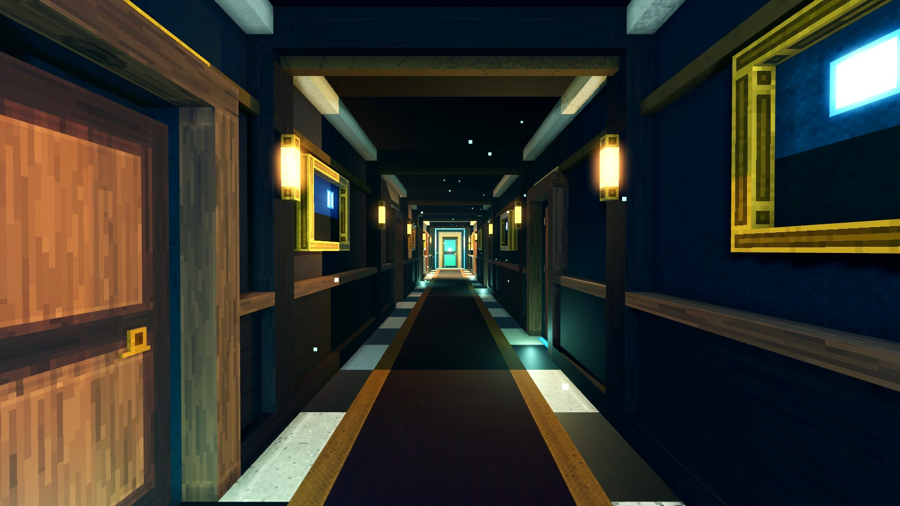
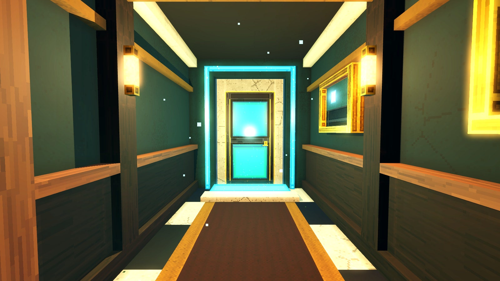
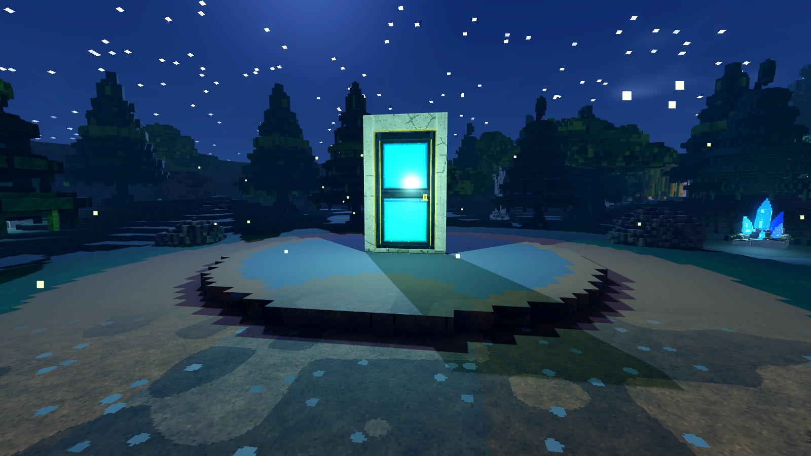
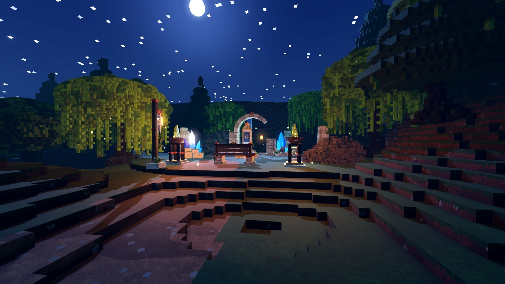

# Wakeless

Jeu d'aventure narratif en 3D, développé sous **Godot 4.3** (GDScript, rendu Forward+).
Le socle technique et graphique vient d'**Éclat** (voxel artisanal, pixels de 2 cm, une palette, un shader) ; Wakeless
en est un jeu **entièrement indépendant** : aucune génération procédurale, des cartes construites à la main.

**État : premier prototype graphique** — pas d'histoire, de dialogues, de personnages secondaires ni d'énigmes.
Il sert à valider l'identité visuelle, les déplacements, l'ambiance et les performances.






## Le prototype

1. **Le Bureau des rêves** (`scenes/levels/bureau_couloir.tscn`, scène de démarrage) : couloir d'hôtel de 26 m, huit portes
   (six fermées à clé, une chambre qui s'ouvre, une « porte du rêve » au bout), chambre simple (lit, tables de nuit, armoire,
   fauteuil, fenêtre de lune), appliques chaudes contre lueurs turquoise, fenêtre de lune au fond, poussières en suspension.
2. **La forêt nocturne** (`scenes/levels/foret_nocturne.tscn`) : 80 × 80 m de relief dessiné, 76 arbres et 12 rochers posés
   un par un, sentier éclairé de lampadaires, ruines (arche, colonnes, braseros, cristaux), lucioles, lune et étoiles.
3. **La transition** : la porte du rêve s'ouvre, fondu au noir, la forêt se charge comme **scène distincte** (jamais de monde
   continu) ; la porte de la clairière ramène au couloir.

## Ouvrir et tester sur Mac

1. Télécharger **Godot 4.3 (ou plus récent 4.x) — version standard, pas « .NET »** : <https://godotengine.org/download/macos/>
   puis glisser `Godot.app` dans Applications (au premier lancement : clic droit → Ouvrir).
2. Récupérer le projet : `git clone https://github.com/rambouraxel-del/Wakeless`, puis
   `git checkout claude/bootstrap-wakeless` (ou bouton **Code → Download ZIP** sur la branche).
3. Dans Godot : **Importer** → choisir le fichier `project.godot` → **Importer et éditer** (la première ouverture importe les
   ressources, quelques secondes).
4. **F5** (ou ▶ en haut à droite) : le jeu démarre dans le couloir. Pour lancer un niveau précis : ouvrir la scène puis **F6**.
5. Dans le couloir, aller jusqu'au bout (la porte turquoise), **E** pour la franchir. Dans la forêt : suivre le sentier éclairé
   jusqu'aux ruines ; la porte de la clairière ramène au couloir.

| Touche | Action |
|---|---|
| Z Q S D ou W A S D (ou flèches) | Marcher (les deux claviers marchent) |
| Souris | Regarder (clic : recapturer la souris) |
| Maj / Espace | Courir / sauter |
| **E** | Interagir (portes) |
| V | Vue à la 1re ou 3e personne (3e personne au lancement) |
| Alt (maintenu) | Strafe : le gardien garde le regard de la caméra |
| F | Champ de vision 68° → 76° → 84° |
| L | Ambiance d'éclairage suivante (essai) |
| F3 | Informations techniques (FPS, triangles, appels de dessin) |
| F1 / F2 | Aller au couloir / à la forêt (développement) |
| F11 | Plein écran |
| Échap | Pause |

Personnage : **Star-Faced One**, gardien des rêves flottant de **1,10 m** (`config/player.json`) : voir [docs/GARDIENS.md](docs/GARDIENS.md). L'explorateur provisoire reste disponible (`--gardien=aucun`).

## Vérifier (sans carte graphique)

```bash
GODOT=/Applications/Godot.app/Contents/MacOS/Godot tools/check.sh
```

Importe le projet, compile les 57 scripts, lance 181 contrôles (voxel, assets, références, niveaux, collisions, déplacements, gardien,
interactions) puis une recette jouée du jeu complet (couloir → forêt → couloir). Détails : [docs/VALIDATION.md](docs/VALIDATION.md).

## Documentation

- [docs/MIGRATION_ECLAT.md](docs/MIGRATION_ECLAT.md) — ce qui vient d'Éclat : conservé, adapté, supprimé, version source.
- [docs/NIVEAUX.md](docs/NIVEAUX.md) — construire et modifier un niveau à la main dans Godot (boîtes, relief, assets, portes).
- [docs/ARCHITECTURE.md](docs/ARCHITECTURE.md) — conventions, chaîne de rendu, organisation du code.
- [docs/DIRECTION_ARTISTIQUE.md](docs/DIRECTION_ARTISTIQUE.md) — direction artistique (identique à Éclat) et adaptation nocturne.
- [docs/VALIDATION.md](docs/VALIDATION.md) — tests réellement effectués, captures, limites.

## Organisation

```
config/       palette.json (matières), lighting.json (ambiances), player.json (échelle, champ de vision)
materials/    shader voxel unique, matériaux, ciel étoilé
scripts/      core (voxel) · rendering · assets (kit de modélisation 2 cm) · game (joueur, caméra, sauvegarde)
              level (Level, SceneDoor, VoxelBox/VoxelStructure) · terrain (HeightmapTerrain) · app (navigation, pause)
assets/props/ assets cuits (arbres, rochers, lampadaires, ruines, mobilier d'hôtel…)
scenes/levels/ les deux niveaux (+ data/ : architecture et relief cuits)    maps/foret/ images du relief
tools/        check.sh, capture/shot, bake_assets, authoring/ (scripts de départ des niveaux)    tests/
```
