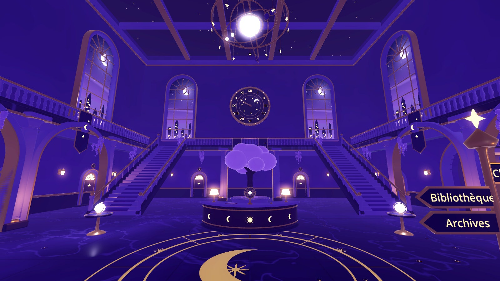
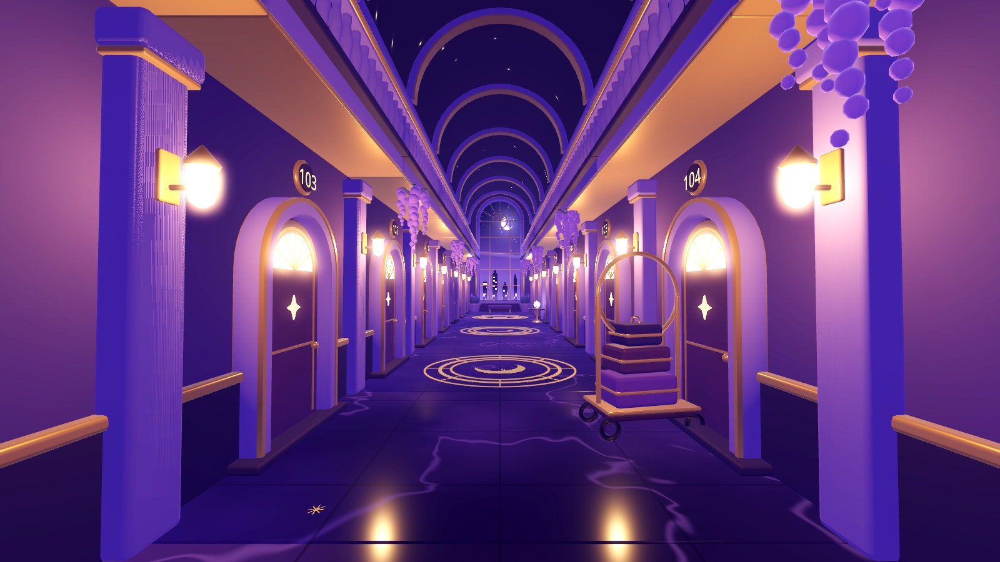
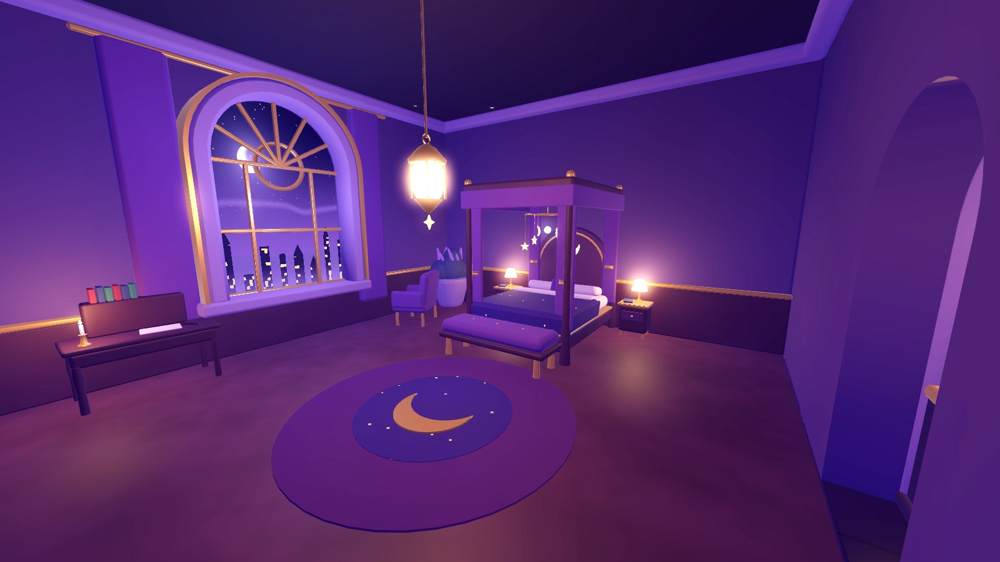

# Le Bureau des rêves — 3D stylisée

Nouvelle direction artistique des environnements de Wakeless : **on quitte le voxel** pour une **3D stylisée, douce et
légèrement arrondie**, cohérente avec Star-Faced One. Le Bureau des rêves est un immense hôtel nocturne : violet, indigo,
bleu nuit, dorures chaudes, clair de lune, étoiles, lunes et lustres astronomiques.

Scène : `scenes/levels/bureau_des_reves.tscn` (**scène de démarrage du jeu**). L'ancien couloir voxel
(`bureau_couloir.tscn`) et la forêt nocturne sont conservés.





## Le secteur

| Zone | Contenu |
|---|---|
| **Grand atrium** (30 × 26 m, 20 m sous plafond) | sol de marbre indigo à incrustations d'or (cercles, croissant, étoiles), réception en arc (lampes, sphère armillaire, cloche, registre), arbre de lune en fleurs, **deux grands escaliers** vers une **galerie à 6 m** qui fait le tour sur trois côtés (balustrades dorées, arcades, colonnes), **lustre astronomique** suspendu (lune lumineuse, trois anneaux de planètes qui tournent, pendeloques d'étoiles), **horloge céleste** (heure réelle), 8 grandes fenêtres en arche sur un paysage nocturne peint, plafond étoilé à caissons, 7 portes numérotées, porte d'entrée monumentale, glycines, bannières, panneau indicateur, chariot à bagages, tables à globe |
| **Couloir des rêveurs** (36 m, 8 travées modulaires) | voûte en berceau étoilée, arcs doubleaux, balcons à balustrade, 16 portes numérotées 101 à 116, appliques chaudes, bannières, glycines, grande fenêtre de lune au fond |
| **Chambre du rêveur** (n° 107, 9 × 8 m) | porte normale qui s'ouvre sur le couloir, lit à baldaquin (couette étoilée, rideaux, mobile d'étoiles), tables de nuit à lampe, armoire, bibliothèque, bureau à bougeoir, fauteuil, tapis au croissant, fenêtre de lune, lanterne |

**Narration** : on entre dans un rêve **en s'endormant dans le lit du rêveur** (« E · Se coucher et rêver ») : Star-Faced One
s'installe sur le lit, joue `sleep`, fondu vers la forêt nocturne. Dans la forêt, la porte de la clairière s'appelle
désormais « Se réveiller » : retour **sur le lit**, où il joue `wake`.

## Star-Faced One

Le personnage est celui de la branche `claude/integration-starface` : `assets/characters/star_faced_one/star_faced_one.glb`
(49 628 triangles, 23 os, 11 animations) et sa scène `scenes/characters/star_faced_one.tscn`. **Rien n'a été recréé ni
modifié** : le niveau utilise le joueur existant (`Explorer` + `GuardianModel`), sa caméra à la 3e personne et ses gestes
(`interact` sur la porte 107, `sleep` au lit, `wake` au réveil).

## Comment c'est construit

```
scripts/stylized/style_kit.gd        primitives arrondies : boîte arrondie, révolution, sphère, tore, extrusion biseautée,
                                     profils (arche, cadre d'arche, mur percé, étoile, croissant), escalier ; fusion par matériau
scripts/stylized/style_materials.gd  32 matériaux PARTAGÉS (materials/stylized/*.tres)
materials/stylized/*.gdshader        surface stylisée (dégradé, variation douce, liseré, étoiles), marbre à incrustations d'or,
                                     voûte étoilée scintillante, paysage nocturne des fenêtres (lune, tours, brume) — sans image
scripts/stylized/style_assets.gd     catalogue des 35 MODULES (colonne, porte, applique, escalier, lustre, lit…)
scripts/stylized/module_builder.gd   assemble un module : un maillage fusionné, boîtes de collision, lumières, pivots
assets/stylized/modules/*.tscn       les modules, instanciables (+ meshes/*.res)
scripts/level/hotel_door.gd          porte d'hôtel (numéro, fermée à clé ou ouvrable)
scripts/level/dream_bed.gd           le lit qui fait entrer dans le rêve
tools/authoring/build_stylized_assets.gd   fabrique matériaux et modules (une fois)
tools/authoring/build_bureau_reves.gd      pose le niveau : chaque position est écrite à la main (aucune génération en jeu)
```

Les modules sont **générés par script une fois** (comme un outil de modélisation) puis versionnés ; le jeu ne fait que les
charger. Le niveau est **disposé à la main** : coordonnées explicites dans `build_bureau_reves.gd`, puis la scène `.tscn`
devient la source de vérité, modifiable dans l'éditeur Godot (déplacer, dupliquer, supprimer des modules ; changer le numéro
ou le verrou d'une porte dans l'inspecteur).

### Ajouter ou modifier un module

1. Écrire ou retoucher sa fonction dans `style_assets.gd` (et l'ajouter à `all_ids()`).
2. `godot --headless -s tools/authoring/build_stylized_assets.gd -- <id>` : toutes les instances du niveau suivent.
3. `tools/check.sh` : contrôle maillage, matériaux partagés, budget de triangles.

## Optimisation

- **Matériaux partagés** : 32 matériaux pour tout le secteur (chaque surface de module en utilise un, contrôlé par les tests).
- **Géométrie maîtrisée** : chaque module est un seul maillage fusionné par matériau (quelques surfaces) ; ≤ 16 000 triangles
  par module ; ≈ 580 000 triangles pour tout le secteur (atrium + couloir + chambre), dont beaucoup hors champ à un instant donné.
- **Éclairage efficace** : 66 lumières, **une seule avec ombres** (le lustre) ; appliques, lanternes, lampes et rayons de
  lune sans ombres ; pas de soleil (intérieur clos : la lumière directionnelle est éteinte) ; reflets des sols polis par SSR
  (Forward+).
- **Collisions** : boîtes simples (murs, sols, galeries, colonnes, meubles) ; escaliers = **rampe lisse** sous les nez de
  marche (montée fluide), balustrades et garde-corps pour ne pas tomber des galeries.

## Vérifications

`tools/check.sh` ajoute `tests/run_checks_bureau.gd` (≈ 325 contrôles : modules, matériaux, structure, budgets, parcours joué
complet — atrium, escalier, galerie à 6 m, balustrade, couloir de 36 m, murs, porte verrouillée, porte 107, chambre, lit) et
une recette du jeu complet (chambre → lit → rêve → réveil). Voir [VALIDATION.md](VALIDATION.md).
